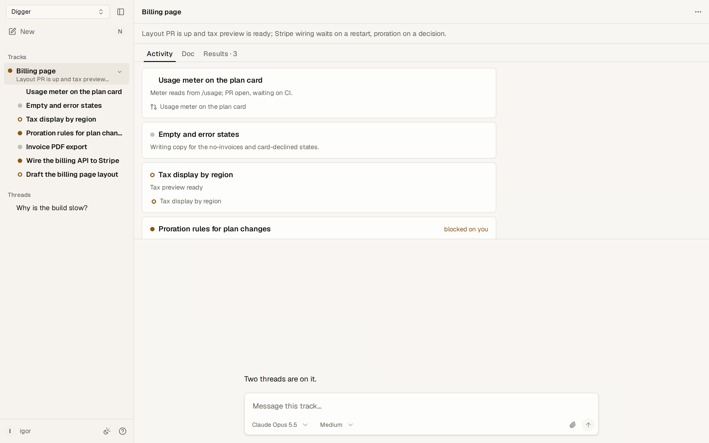
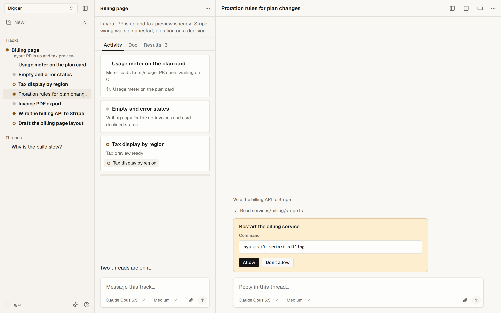
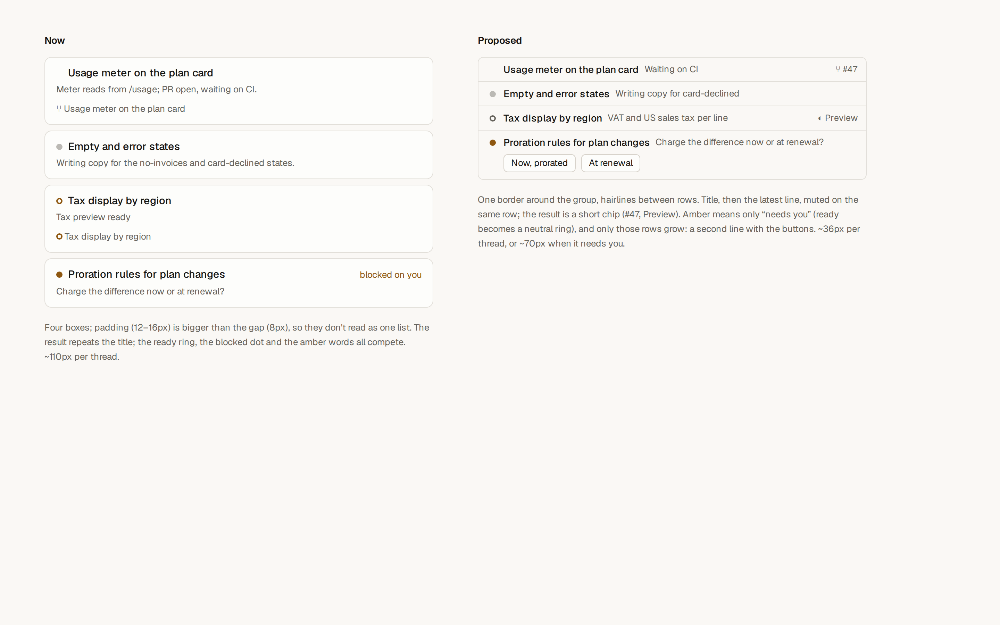
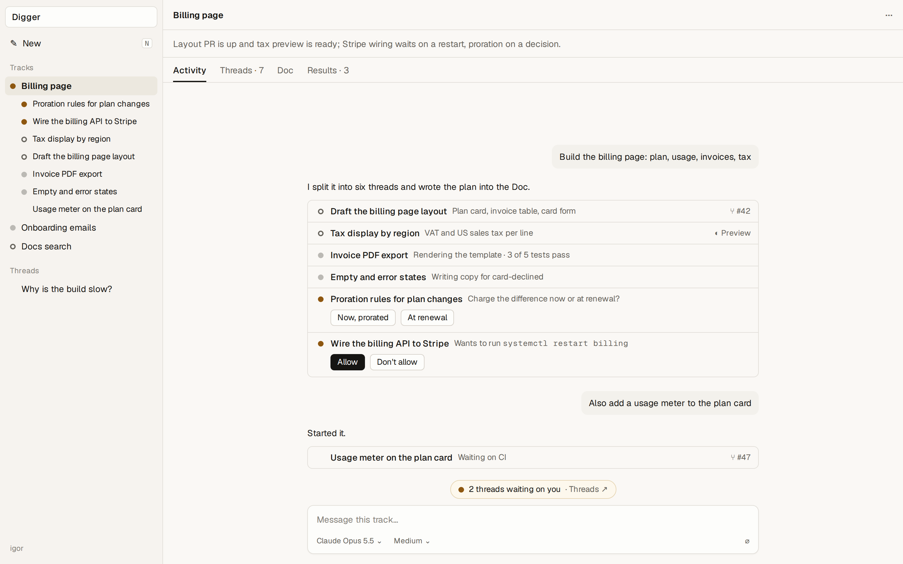
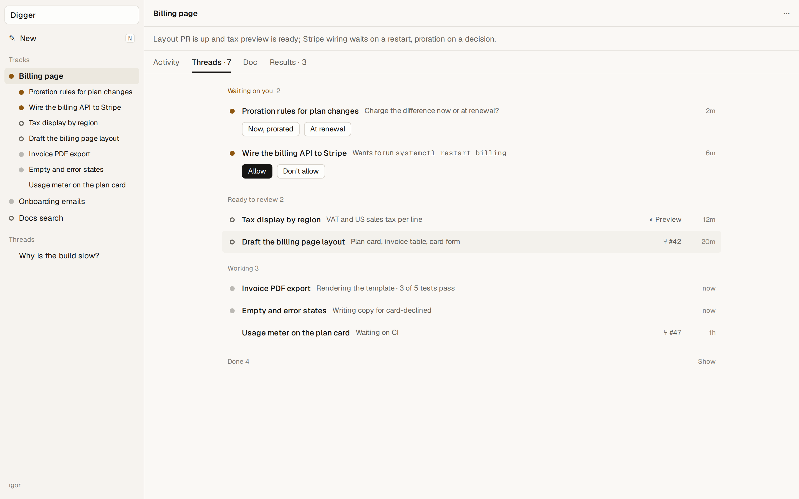
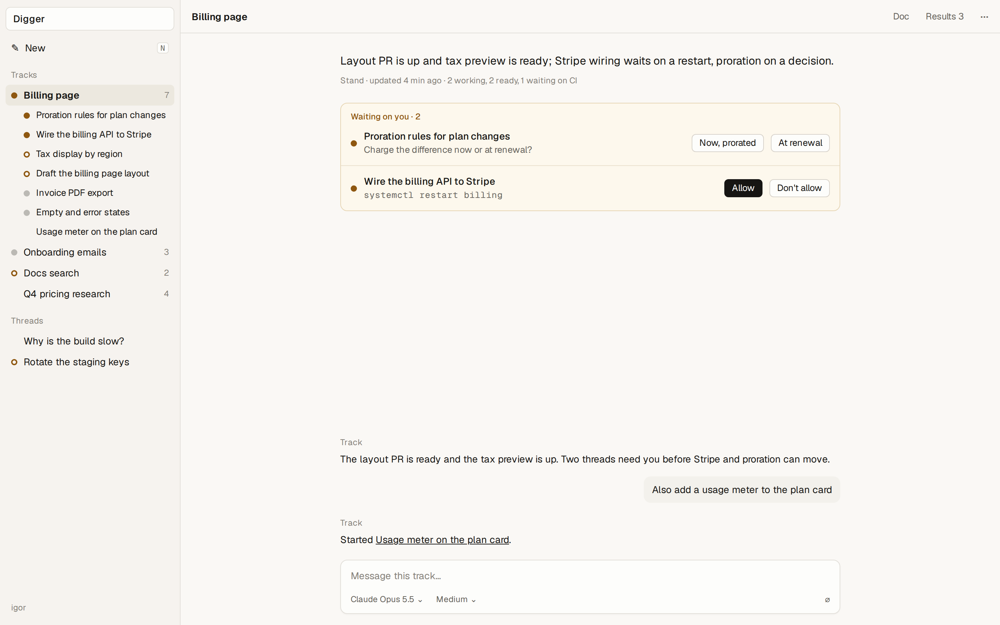
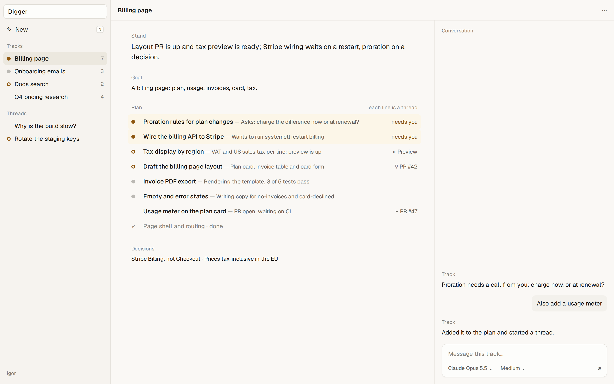
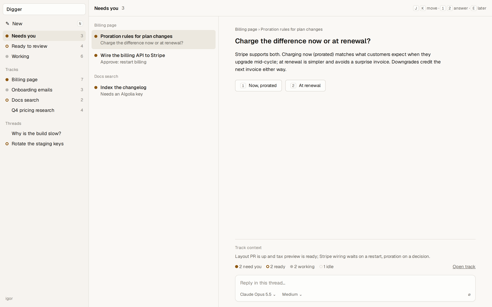
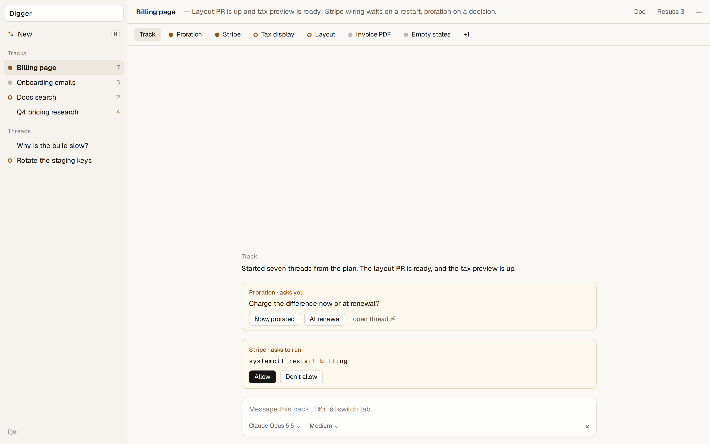
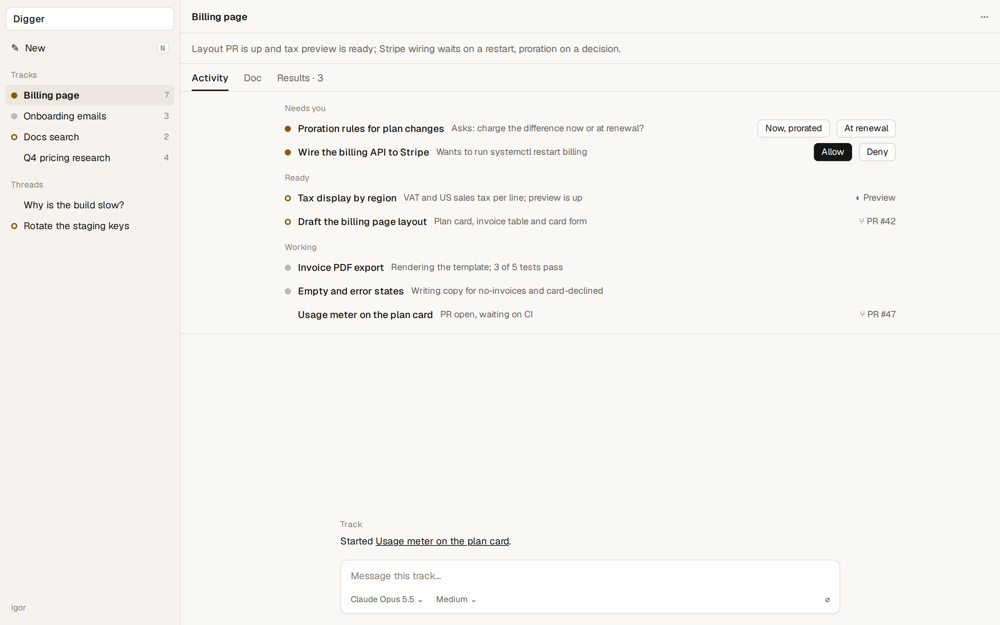

# Track layout: five directions

All mockups are 1440×900 in the app's palette, built from the same sample track: "Billing page", 7 threads, 2 blocked on the person.

## What's cluttered today

1. Every thread is listed twice: once in the sidebar tree, once as a card.
2. Cards are ordered by when they started. The two threads blocked on the person sit below the 40% cut-off.
3. Four stacked bands (header, stand, tabs, cards) come before the track's conversation. The track agent's latest line lands far below its stand.
4. Opening a thread makes three panes with two composers. The track pane drops to about 340px and every card wraps.

## Prior art drawn on

- **Linear**: the Inbox, issue lists grouped by status, and project updates (the closest match to a stand).
- **Slack**: a channel with a single thread panel. One conversation is in focus at a time.
- **Superhuman**: a triage queue worked one item at a time from the keyboard.
- **Things and Notion**: a project is a quiet page, and its to-dos are its body.
- **GitHub**: the PR checks list. Dense rows each carry a status mark, and only failures draw attention.

## Directions

| | Idea | What changes | Gains | Costs |
|---|---|---|---|---|
| A | The sidebar lists the threads | No cards. The pane is the stand, a pinned "Waiting on you" box with inline answers, and the track conversation. A thread opens in place of the track, with a breadcrumb back, not as a third pane. | Duplication gone; urgent items always first; one conversation on screen; smallest build | The sidebar gets long with several tracks open; each thread's line shows only on hover or when opened |
| B | The track is a page | The Doc is the body. The Plan lines are the threads, live. The conversation becomes a right column. | Strongest "why and where" story; the plan and the progress can't drift apart | The agent has to keep plan lines tied to threads; less room for chat; a larger change to the model |
| C | Inbox first | The app opens on "Needs you / Ready / Working" across all tracks, worked from the keyboard. A track becomes context at the foot of each item. | Fastest triage; scales to many tracks | The track recedes into a filter; a big change to navigation |
| D | Threads as tabs | A tab strip under the track header. One conversation at a time; asks are pulled into the Track tab. | Never more than one conversation; quick to switch | Tabs overflow past about 8; thread lines are hidden; position carries no meaning |
| E | Rows, not cards | Keeps today's structure. Cards become 34px rows grouped Needs you / Ready / Working, with answers inline. | Cheapest; fits 7 threads above the fold | The duplication and the three-pane problem stay |

## Round 2: a Threads tab, plus minicards in the chat

Direction from review: move threads out of the top of the pane into a **Threads** tab, and show them as inline minicards in the track conversation, the way subagents appear in a thread. Threads then show up on every surface: the sidebar tree, the chat, and the tab.

### Why the current cards feel off (H.png)

- Padding (12–16px) is bigger than the gap between cards (8px). Inside space beats outside space, so they read as four boxes, not one list.
- Every thread gets a filled, bordered box on a background of nearly the same tone. The borders carry all the structure.
- The result chip repeats the thread's title.
- The cards sit on a different left edge from the centered conversation below them.
- The ready ring, the blocked dot and "blocked on you" all use amber, so nothing stands out.

### The new anatomy

- **One border around a group of threads, hairlines between rows.** This is the subagent block's chrome (`rounded-md border`), so threads and subagents look like siblings.
- **One line per thread**: mark, title, the latest line muted on the same row, and a short result chip (`#47`, `Preview`) instead of the title again.
- **Amber means only "needs you"**: ready becomes a neutral ring. Only rows that need the person grow, with a second line carrying the buttons.
- About 36px per thread (70px when it needs the person), against about 110px today. Same 45rem measure as the conversation.

### Activity: minicards where the track agent started them (F.png)

The minicards update live in place. A "2 threads waiting on you" pill above the composer jumps to the Threads tab, so a blocked thread far up the scroll is never lost.

### Threads tab: grouped by what they need (G.png)

The groups are Waiting on you, Ready to review, Working, and Done (collapsed). Each row carries the time since it last changed, and asks are answered inline.

### Open questions

- When a thread blocks, should its minicard also re-post at the bottom of the chat, or is the pill enough? I'd start with the pill.
- Ready as a neutral ring changes the spec's mark (§3). That needs a decision, since the sidebar uses the same marks.

## Round 1 mockups

### A

### B

### C

### D

### E

## Recommendation

**A, plus C's "Needs you" entry at the top of the sidebar.** It removes the root causes: the duplicate list and the third pane. What waits on the person gets a fixed place on every track, and "Needs you" gives them one place across tracks. E is a fine stopgap if A is too big for now. B is worth revisiting once the Doc's Plan is structured.

To regenerate: `python3 gen.py` writes A–E.html (styles in `s.css`; Geist font files come from `web/node_modules/@fontsource-variable`), then screenshot them at 1440×900.
