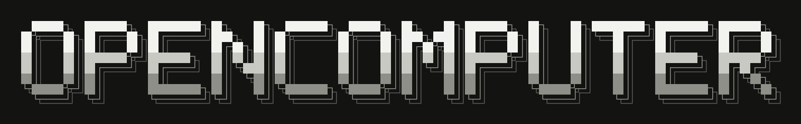
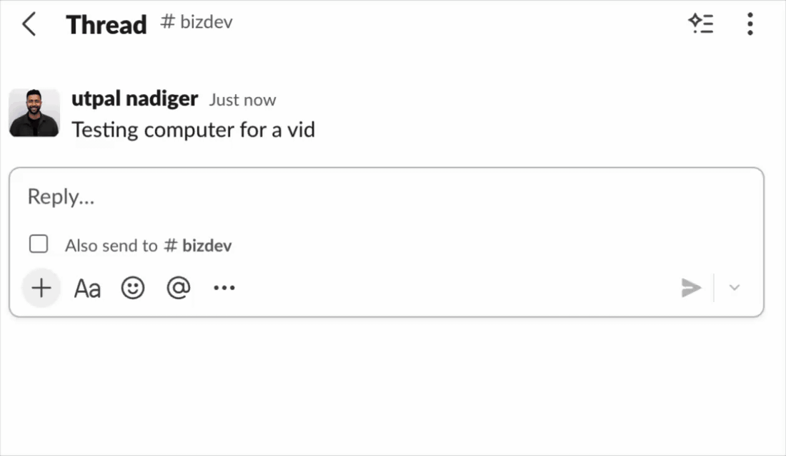
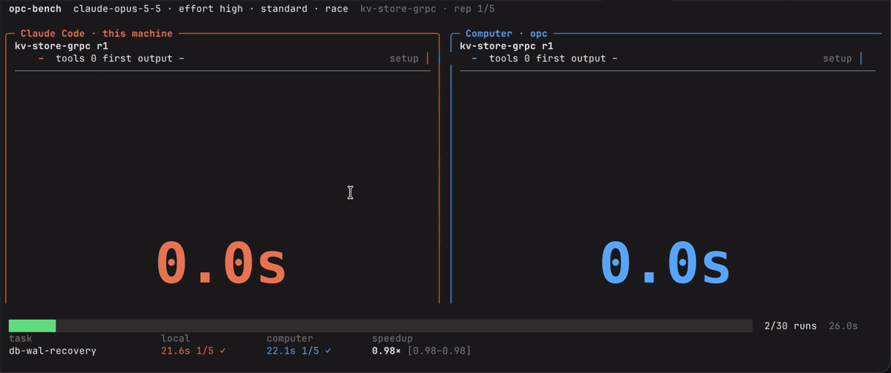
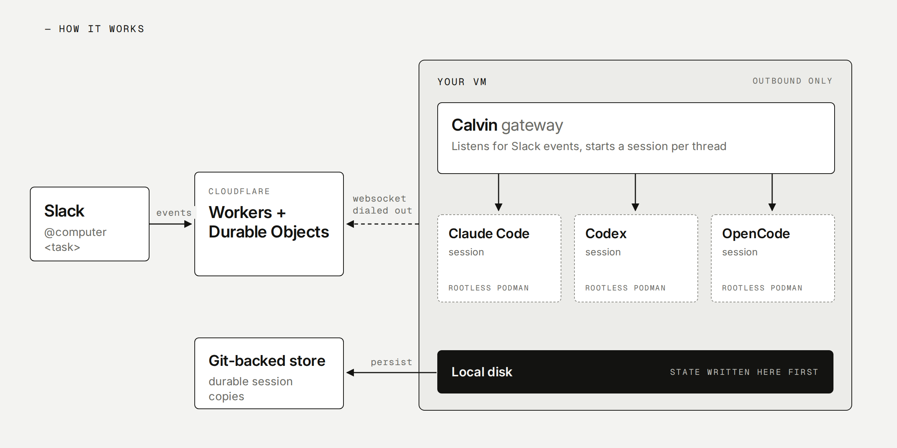
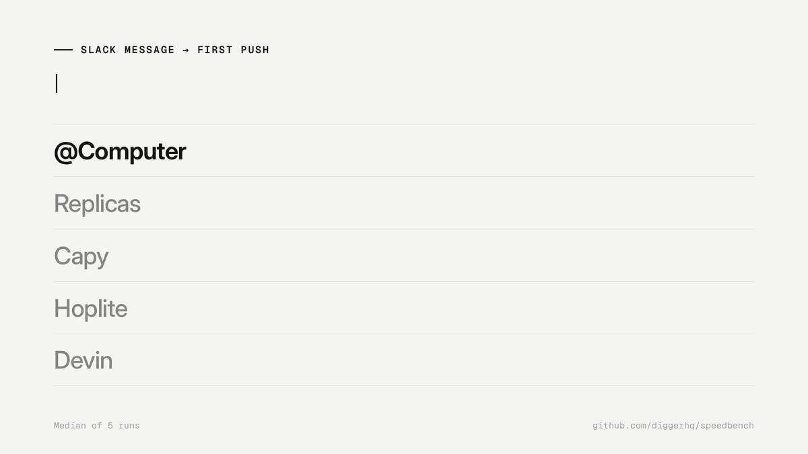

<!--
README outline for the @computer OSS launch. Headings and a one-line goal per
section only; copy to be written once the shape is agreed.
Scope: @computer only. Serverless Agents and the sandbox platform get at most a
link in "Docs".
-->

  

  The open-source Devin alternative: a coding agent your team works with in Slack, on its own computers, in your cloud or ours.

  <a href="#">Cloud</a> | <a href="#">Self-hosting</a> | <a href="#">Docs</a> | <a href="#">Website</a> | <a href="#">Benchmark</a> | <a href="#">Community</a> | <a href="#">X</a>

  
  

  

TODO: replace the dummy `#` links. Benchmark → https://opencomputer.dev/blog/cloud-agents-as-fast-as-local/; Community and X still to decide; Self-hosting once the docs in #1024 have content.

## Introduction

OpenComputer is the open source, self hostable alternative to Devin. Mention `@computer` in a Slack thread with a task, it works on its own computer, you & your team can watch and steer it as it goes, and the result lands as a pull request.

It is open source from the compute layer up, so you can run all of it in your own cloud account, or start on OpenComputer Cloud in two minutes.

We built it to feel as fast as Claude Code on your laptop: in our benchmark it opens PRs 3.3x faster than Devin.

## See it work

_Goal: the reader sees a real thread in under 10 seconds: mention, live progress, steering mid-turn, PR opened._

  

TODO: caption on how fast it answers in Slack. Still wanted: a longer thread showing live progress, steering mid-turn and a PR opened.

  

TODO: caption: "As fast as Claude Code on your own machine." Same task, same model, real time.

From launch post: it also wants GIFs that show the speed; make one set for both.

## How it works

OpenComputer is built to be simple to self-host without giving up scale or security. The whole stack runs on a single VM, which we recommend locking down to outbound-only network access.

The VM runs the gateway, Calvin: a thin bridge that listens for Slack events and starts a session with Claude Code, Codex or OpenCode, depending on your configuration. Each session is isolated with rootless Podman. Its state is written first to the VM's local disk, then persisted to a git-backed store.

The rest of the stack runs on Cloudflare Workers and Durable Objects. Support for Fly and other platforms is coming soon.

  

TODO: link to Architecture docs. Diagram source: `scripts/readme-architecture.html`.

From launch post: it wants the same two visuals: (1) VM per session vs one VM per team with isolated sessions on top; (2) the gateway spawning sessions and worktrees, backing them up after each turn, scaling out. Draw once, use in both.

## Try it in Cloud

The fastest way to experience `@Computer` is to install the Slack app from the cloud: [sign up here](https://app.opencomputer.dev), connect your repos, and install the Slack app to get started.

  

- **3.3x faster than Devin**: all 4 PRs open with CI green in 56s vs 185s ([benchmark](https://opencomputer.dev/blog/cloud-agents-as-fast-as-local/))
- **2.6x faster than the average of the 4 most popular cloud agents**: first push in 24s vs a 62s average ([benchmark](https://opencomputer.dev/blog/cloud-agents-as-fast-as-local/))
- **3-day free trial** with 600 work minutes
- **Bring your own ChatGPT / Codex subscription**

## Self-host

_Goal: the reader knows self-hosting is real and supported, what it needs, and where the guide is, without the README becoming the guide._

TODO: requirements in one line (Slack app, GitHub App, model key, domain, one VM), a short install snippet, links to the quickstart and AWS / Azure / GCP / VPS guides.

From launch post: AWS, Azure, GCP and OCI, Kubernetes soon; the whole stack can run on a single VM. (Docs nav lists AWS / Azure / GCP / VPS, no OCI yet.)

## License

Apache 2.0. See [LICENSE](LICENSE).
