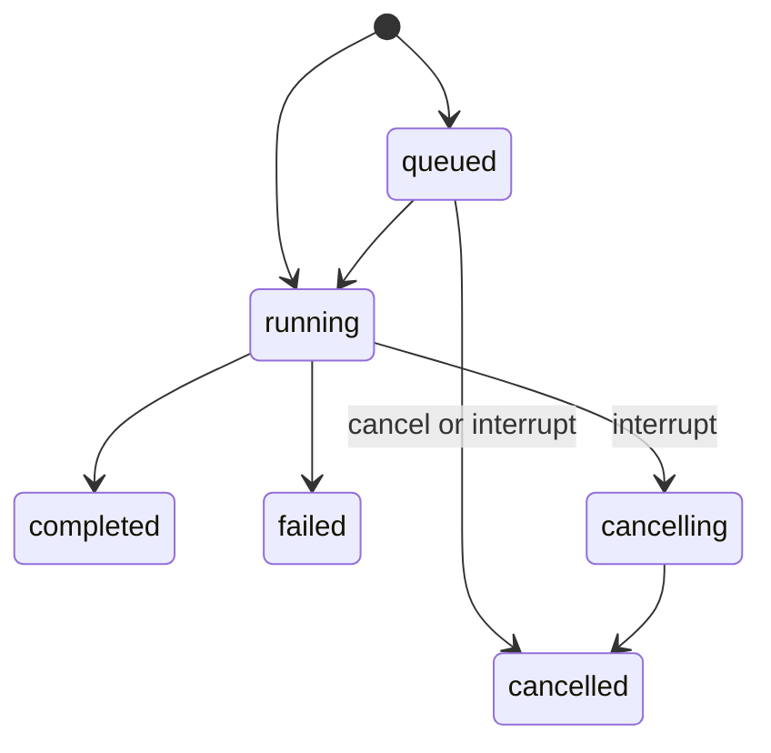

<Note>Not in the public code yet: launch blocker 4 (API on a self-hosted instance). See [API overview](/api/overview).</Note>

A turn's id is `tn_` followed by 12 characters.

## Send

`turns.send` (`POST /sessions/{id}/turns`) takes `input` (1 to 100,000 characters) and, optionally, `ifBusy` and `idempotencyKey`.

```json
{"jsonrpc":"2.0","id":3,"method":"turns.send","params":{"sessionId":"cs_0123456789abcdef","input":"Add a test for the empty case","ifBusy":"steer","idempotencyKey":"7f3c1c0e-1"}}
```

```json
{"jsonrpc":"2.0","id":3,"result":{"turn":{"id":"tn_0123456789ab","status":"running","...":"..."},"delivery":"steered","duplicate":false,"seq":412}}
```

| Session state | `ifBusy` | What happens | `delivery` | `turn` in the result |
| --- | --- | --- | --- | --- |
| Idle, nothing queued | Any | The turn starts | `started` | The new turn |
| Busy | `queue` (default) | The message waits as a `queued` turn. Queued turns start in order. Open asks stay open | `queued` | The new turn |
| Busy | `steer` | The message joins the running turn's `steering` list. Open asks close as `declined`; the message is the answer. With no running turn the message is queued | `steered` | The running turn |
| Busy | `interrupt` | Queued turns are cancelled and the running turn goes to `cancelling`. The message becomes a new turn that starts once the harness has stopped | `started` | The new turn |

A send to a suspended session is recorded as a `queued` turn and starts a runner.

Each send records a `message.received` event; a steer also records `turn.steered` on the running turn.

| Error | Cause |
| --- | --- |
| `409 queue_full` (`retryable: true`, `retryAfterMs: 5000`) | The session already holds 20 queued turns |

## Status



| `status` | Meaning | Event |
| --- | --- | --- |
| `queued` | Waiting for the running turn to end | `turn.queued` with `position` |
| `running` | The harness is working | `turn.started` with `model`, `effort`, `mode` |
| `cancelling` | Interrupted; the harness has not stopped yet | `turn.status_changed` |
| `completed` | Ended normally. `text` is the final message | `turn.completed` |
| `failed` | Ended with an `error` (`code`, `message`) | `turn.failed` |
| `cancelled` | Interrupted or withdrawn. `reason` says which | `turn.cancelled` |

A turn with `trigger: "subagent"` was started by the harness, not by a message; see [Subagents](/api/subagents).

## Wait for the result

| Transport | How |
| --- | --- |
| WebSocket | Attach to the session and read [events](/api/events) until `turn.completed`, `turn.failed` or `turn.cancelled` for the turn id |
| HTTP | Long-poll `turns.get` (`GET /sessions/{id}/turns/{turnId}`) |

```
GET /sessions/cs_0123456789abcdef/turns/tn_0123456789ab?waitMs=60000
```

| Param | Effect |
| --- | --- |
| `waitMs` (up to 60,000) | Returns when the turn has ended or the wait is over. Check `status` and call again if it has not ended |
| `status` | Returns when the turn has left this status instead |
| `minSeq` | Waits for the journal: [Session journal](/api/overview#session-journal) |

The ended turn carries `text`, `error`, `usage` (tokens and `costUsd`), `startedAt` and `endedAt`. A turn that stopped for a person has an open [ask](/api/asks) on the session.

## Cancel a queued turn

`turns.cancel` (`POST /sessions/{id}/turns/{turnId}/cancel`) withdraws a `queued` turn: it ends as `cancelled` with `reason: "withdrawn"`.

| Error | Cause |
| --- | --- |
| `409 turn_not_cancellable` | The turn is not `queued`. The error carries the turn |

## Interrupt

`sessions.interrupt` (`POST /sessions/{id}/interrupt`) cancels every queued turn and stops the running one. It returns at once with the session.

| Case | Result |
| --- | --- |
| Running turn | Goes to `cancelling`; when the harness stops, ends as `cancelled` with `reason: "interrupted"` |
| Harness not stopped 10 seconds after the first interrupt | The harness process is ended and the turn is cancelled with `forced: true` |
| Open asks | Close as `interrupted` |
| `turnId` given | Does nothing unless that turn is the running one or is queued |
| Suspended session whose journal shows a started turn (its runner died) | That turn ends as cancelled with `forced: true` |

{/* Sources: computer/schema/computer-api.v1.json (Turn, SendResult, turns.*, sessions.interrupt, turn events); computer/src/runner/api/api.ts (send, steer, interruptWith, cancelQueued, FORCE_CANCEL_MS, QUEUE_MAX); computer/src/runner/api/asks.ts (steer declines asks); computer/src/host/session-writer.ts (queued send, cancelOrphan); computer/src/api/read-methods.ts (turns.get waitMs, status, minSeq); opc/src/cmd/follow.rs (turns.get use) */}
