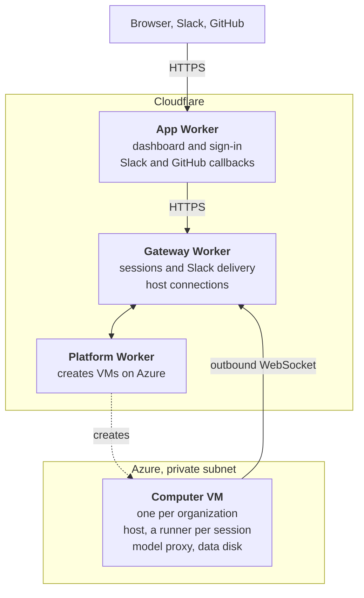

A self-hosted deployment runs the same stack as the hosted service, in your accounts:

The Computer VM has no public IP. It reaches the internet through a NAT gateway and connects out to the gateway Worker; nothing connects in.

## What you need

| Account or tool | Used for |
| --- | --- |
| Cloudflare account with a zone (domain) you control | Workers, D1, KV, R2 and Durable Objects. The gateway Worker needs a custom domain on the zone: Worker-to-Worker requests on `workers.dev` do not arrive. |
| Azure subscription | The Computer VMs, their network and the bootstrap storage. You need rights to create role assignments and app registrations. |
| WorkOS account | Sign-in to the dashboard |
| Slack workspace | A Slack app you create |
| GitHub account or organization | A GitHub App you create |
| Anthropic API key | Model calls from every session |
| Git, Node.js 22 or newer, npm, Go, Azure CLI, Wrangler 4 | Building and deploying |

## Choose where the VMs run

| Cloud | Status |
| --- | --- |
| [Azure](/self-hosting/azure) | Supported |
| [AWS](/self-hosting/aws) | Not supported yet |
| [Google Cloud](/self-hosting/gcp) | Not supported yet |

{/* Sources: services/managed-agents/scripts/stack.mjs:82-84 (workers.dev subrequests); services/managed-agents/scripts/computers-infra.sh (NAT, private subnet); services/managed-agents/src/platform/computers/resources.ts (no public IP, cloud-init); services/managed-agents/src/computer/model-key.ts:95-103; cloudflare-workers/api-edge/src/index.ts (WorkOS) */}
